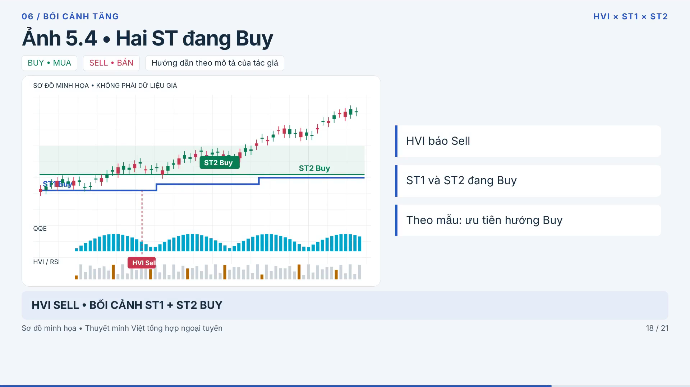

# Video hướng dẫn HVI × ST1 × ST2

Video ngang Full HD, 24 fps, dài khoảng **8 phút 15 giây**, có thuyết minh tiếng Việt.

- [Tải video MP4](indicator-tutorial/huong-dan-HVI-ST1-ST2.mp4)
- [Tải gói bản dựng](indicator-tutorial/ban-dung-nguon.zip)
- [Kịch bản thuyết minh](indicator-tutorial/narration.txt)
- [Phụ đề SRT](indicator-tutorial/thuyet-minh.srt)
- [Mốc chương](indicator-tutorial/chapters.txt)
- [Mã nguồn video và hướng dẫn xuất lại](indicator-tutorial/README.md)
- [Hai indicator Pine gốc](indicators/)

## Nội dung và giới hạn của bản dựng

Giải thích logic HVI, ST1 và ST2, hai mẫu tín hiệu cơ bản, các ngoại lệ trong ảnh 3–5 và cách chờ giá hồi. Phần Fibonacci sử dụng cách hiểu đã được tác giả xác nhận: giá hồi vào vùng 0.618–0.786 rồi bị từ chối, nên ưu tiên Sell.

Biểu đồ trong video là **sơ đồ dựng lại theo ảnh mẫu**, chưa phải ảnh chụp TradingView gốc. Thuyết minh dùng giọng Việt tổng hợp ngoại tuyến, còn âm sắc máy. Hai file Pine gốc được giữ nguyên; quy tắc giao dịch bổ sung của tác giả chưa được tự động hóa toàn bộ trong indicator.

Video đã được kiểm tra giải mã toàn bộ, có hình H.264 1920×1080 và âm thanh AAC. Bản dựng HyperFrames đã qua kiểm tra runtime, bố cục, hoạt ảnh và tương phản; còn cảnh báo về chữ nhỏ trong biểu đồ và khung hình mở đầu trống do fade.

Các khung hình, audio, mã nguồn và bản xuất cuối được lưu kèm. Không đưa bộ thư viện cài đặt, cache, log tạm hoặc các đoạn video trung gian vào kho. Một số script tạo nguồn ban đầu còn tham chiếu đường dẫn `/workspace`; xem hướng dẫn trong thư mục bản dựng. `export_video.py` dùng đường dẫn tương đối để xuất lại từ tài nguyên đã có.
